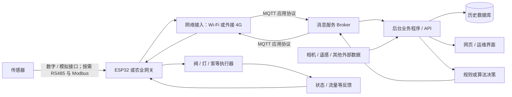

# ESP32 智慧农业系统学习路线

## 这份路线的目标

这是一份从已有 ESP32 实践出发，逐步走到智慧农业系统设计、开发和田间验证的长期学习大纲。主线围绕一个持续迭代的“小型农业采集与灌溉控制系统”，将开发板、传感器、电路、嵌入式程序、通信、后台、数据与田间设备连起来。

目标不是把每个领域都学到专家程度，而是理解每一层的职责与接口，能查对应资料、完成简单实例、看懂系统为何工作，并能按层定位问题。做算法研发时，也能把模型输出可靠地接到设备与农事流程中。

## 背景与当前起点

正在攻读 PhD，从事智慧农业算法研发，工作涉及气象、土壤墒情、物候相机、作物长势和遥感等数据，希望支持灌溉、施肥、大棚控制及农事管理，并最终帮助降本增效。

已经做过：

- ESP32 基本开发和温湿度采集。
- LCD 显示传感器数据。
- 使用 ESP32 自带网页，在本地浏览器显示信息。
- 手机与开发板处于同一 Wi-Fi 时控制灯或阀，并做过初步阈值控制。

目前还没有独立后台和历史数据库。下面的路线从这些已完成的基础继续，不重复安排入门演示，也不把设想中的案例写成已完成成果。

## 能力目标与系统全貌

最终希望能独立搭出一个小型农业系统原型：传感器数据经设备或网关进入后台，相机、遥感和其他外部数据也可直接进入后台；后台保存历史，算法或规则产生决策，再由控制器驱动执行设备并反馈状态。遇到断网、断电或设备异常时，能找到问题并改进设计。

图中的连接分属不同层次：数字/模拟接口或 RS485 是传感器与 ESP32/网关之间的设备接口；RS485 是物理接口，Modbus 是可按设备需要使用的通信协议。Wi-Fi 或 4G 负责让 ESP32/网关接入网络；MQTT 是设备与消息服务之间的应用层消息协议，运行在网络连接之上。它们不是可互换的同一类连接。相机、遥感等外部数据也可以由相应系统直接送入后台。

Broker 负责转发消息；后台业务程序负责解析、校验、权限、业务逻辑和 API；数据库负责持久化与查询。学习初期可以让一台电脑同时运行 Broker 和后台程序，数据保存在 SQLite 等本地数据库中，但要知道它们是不同角色。

贯穿路线的系统演进为：**开发板原型 → 自制基础板 → 农业接口与 4G → 完整后台服务 → 田间小试点 → 根据问题改版**。先接触数据与控制闭环，再逐步深入每层，不要求先掌握所有理论。

## 阶段总览

| 阶段 | 主题 | 阶段产物 |
|---|---|---|
| 0 | 最小端到端闭环 | ESP32 采集、局域网电脑后台、消息通信、历史记录、控制与状态反馈的可运行原型 |
| 1 | 电工电子基础 | 能读懂开发板主要电路，并测量和搭建简单低压输入、输出电路 |
| 2 | 嵌入式深化 | 结构清晰、可调试、通信等待不影响本地保护的设备程序 |
| 3 | 原理图与 PCB | 围绕 ESP32 模组设计、制造、上电调试并改版一块基础板 |
| 4 | 农业设备与通信 | 传感器校准、真实执行装置与反馈、按需求接入 4G 或农业设备接口 |
| 5 | 后台服务深化 | 可维护、可查询、能区分多设备并支持模型或规则接入的服务 |
| 6 | 集成与田间试验 | 有故障记录和效果评价的小试点，以及依据试验改进的第二版 |

## 阶段 0：最小端到端闭环（当前下一步）

### 要学什么

- 理解设备如何发布采集数据、后台如何接收和保存、控制命令如何返回设备。
- 初步了解 MQTT 的主题、发布、订阅、消息载荷，以及 Broker 在链路中的作用。
- 了解后台业务程序与历史数据库的分工；用 SQLite 等轻量数据库保存数据并查询。
- 认识设备状态反馈、命令确认和基本超时保护的作用。
- Python 可在熟悉或服务算法时优先使用；若尚不熟悉，就把它作为需要逐步学会的工具，不预设已掌握。

### 动手实践

沿用现有 ESP32、温湿度传感器和局域网电脑：让 ESP32 通过 MQTT 上传读数；电脑运行 Broker 和一个独立后台程序，由程序接收数据并写入本地历史库；用简单页面或接口查看当前值和历史记录；通过后台发送手动或简单自动控制命令，以灯模拟执行器，并让设备回报状态。为命令增加基本超时保护，避免网络等待卡住设备本地控制。

### 交付物

- 可运行的局域网原型。
- 一张标明 ESP32、Broker、后台程序、数据库和网页职责的系统图。
- 可查询的历史数据，以及一次从控制命令到设备状态反馈的记录。

### 验收

- 能从头解释一条传感器读数如何到达后台并写入历史库。
- 能区分 Broker 消息中转、业务程序处理和数据库存储。
- 能发出控制命令并看到设备状态反馈；网络中断或命令超时不会让本地基本保护失效。

## 阶段 1：电工电子基础

### 要学什么

- 电压、电流、电阻、功率，串并联与基本电路分析。
- 电阻、电容、二极管、三极管和 MOSFET 的常见用途。
- 数字与模拟信号、逻辑电平、上拉与下拉、ADC 的基本概念。
- 稳压、去耦、负载驱动和基础保护；读数据手册和原理图。
- 使用万用表测量电压、通断、电阻和电流；逐步认识示波器与逻辑分析仪。

### 动手实践

读自己开发板的原理图，找到供电、主控、下载电路和常用接口；搭一个低压输入电路与一个低压输出电路，测量关键节点，并练习从现象定位接线或电路问题。

### 交付物

- 开发板主要功能电路的标注图。
- 一份低压输入、输出电路的原理图或接线图与测量记录。

### 验收

- 能说明常见元件在电路中的作用，解释基本选值依据。
- 能用测量结果判断供电、信号或负载侧的常见问题。

## 阶段 2：嵌入式深化

### 要学什么

- 按项目需要补 C/C++、指针、内存和模块化；以当前 MicroPython/ESP32 实践为入口，不必一次性把语言学完。
- 掌握 GPIO、定时器、中断、ADC、UART、I²C、SPI 的用途和常见调试方式。
- 用非阻塞状态机、超时和异常处理组织采集、通信与控制。
- 当任务并发和时序需求确实增加时，再深入 RTOS、任务、队列和同步机制。

### 动手实践

将已有程序整理成采集、通信、控制和故障处理等清楚模块。模拟通信延迟或中断，确认本地控制与保护不被等待网络的代码拖住；练习替换传感器或驱动模块。

### 交付物

- 模块化的设备程序及其状态/错误说明。
- 一份常见故障的串口日志或调试记录。

### 验收

- 能改换一个模块或驱动，而不必重写整套程序。
- 能从日志、测量和代码流程定位常见故障，并解释超时与异常如何处理。

## 阶段 3：原理图与 PCB

### 要学什么

- 从需求列功能、接口和器件，选择现成 ESP32 模组并阅读其参考设计。
- 画原理图、整理 BOM、选择封装；理解原理图表达电气连接与参数，PCB 表达元件的物理布局和走线。
- 学习布局、布线、电源与接地、ERC/DRC 检查、制造文件、打样、焊接或贴装、上电检查和改版。
- KiCad 是可选工具，不要求先购买设备或物料。

### 动手实践

第一块板围绕现成 ESP32 模组设计：包含可靠供电、下载/调试接口、一个传感器接口和一个简单低压输出。先保证易测、易改；4G 和多种农业接口留到后续。无需从裸芯片射频设计起步。

### 交付物

- 原理图、BOM、PCB 布局、制造文件和装配/测试记录。
- 至少一次根据实际问题修订的板卡版本。

### 验收

- 走完“设计—检查—制造—上电—调试—修改”的完整过程。
- 能依据原理图测量关键电源和信号，并说明板上主要连接。

## 阶段 4：农业设备与通信

### 要学什么

- 按农业场景选择传感器量程、精度和安装方式，学习校准、测量和漂移检查。
- 根据实际设备需求学习 RS485 与 Modbus；RS485 是常见物理接口层，Modbus 是通信协议，两者不是同一层概念。模拟量接口也按设备需求学习。
- 了解阀、泵等负载的驱动、供电、保护与流量反馈。
- 通过 UART 接 4G 模块时，学习 AT 命令、SIM、信号、网络注册、APN、供电、天线、认证、加密和重连。
- 区分独立联网设备和由网关汇聚的方案；串口接 4G 不依赖 Wi-Fi 或蓝牙，蓝牙本身也不等于互联网。
- 4G 设备不能默认访问家中电脑的局域网地址；可让设备和电脑都主动连接到双方可达的消息服务。

### 动手实践

把阶段 0 的虚拟灯逐步替换为真实低压执行装置，增加适合场景的传感器或流量反馈，再按实际联网需求接入 4G 并复用后台链路。先学会传感器的选型、接入、校准和测量电路；材料与芯片制造作为专项选修。

### 交付物

- 一套传感器、控制器、执行装置和反馈组成的台架系统。
- 设备通信和测量校准记录。

### 验收

- 能区分“收到控制指令”“控制器报告已执行”和“实际发生供水”等不同证据。
- 能说明设备如何联网、断线后如何恢复，以及传感器数值如何校准和判断异常。

## 阶段 5：后台服务深化

### 要学什么

- 消息解析与数据校验、SQL 查询、API 和简洁网页；展示当前值与历史曲线。
- 设备身份、权限和认证，区分不同设备的数据与命令。
- Linux/服务器部署、自动启动、日志、备份与恢复。
- 模型接口与版本管理、决策记录和结果追溯。
- 以实际维护需要决定是否使用容器或更复杂架构，逐步增加，不堆叠技术栈。

### 动手实践

从阶段 0 的本地后台继续迭代，接入至少两个设备，分别保存数据并验证控制路由；增加查询页面或接口，记录模型/规则版本与决策依据，再部署到适合当前实验的运行环境。

### 交付物

- 可以持续运行、查询和维护的小型服务。
- 部署说明、日志样例、备份与恢复记录。
- 数据、设备命令与算法决策之间的追溯记录。

### 验收

- 能部署并维护这套小系统，解释数据从设备进入服务、保存、查询和形成决策的全程。
- 能区分不同设备，并在后台故障时通过日志和数据检查定位问题。

## 阶段 6：系统集成与田间试验

### 要学什么

- 设备供电、功耗、外壳、防水、接线与安装维护。
- 断电、断网、缓存补传、重启恢复、数据过期、重复命令和执行失败的处理。
- 本地保护、人工接管、配置诊断与固件升级。
- 模型从离线历史回放、生成建议，到逐步自动控制，并保留后备规则。
- 与人工操作、固定时程或简单阈值进行对照，评价水肥用量、人工成本、作物表现、系统稳定性和维护成本。

### 动手实践

做一个范围明确的小试点，连续记录设备、网络、控制和农事结果。先比较算法建议与实际操作，再按风险和证据逐步扩大自动化；根据故障记录和效果评价制作第二版。

### 交付物

- 自制基础板、农业传感器/执行设备和服务组成的小试点系统。
- 田间运行与故障记录、效果评价，以及第二版改进说明。

### 验收

- 能说明系统何时控制、为何控制、是否执行、对作物与资源产生了什么结果。
- 能基于记录提出并完成至少一项软硬件改进。

## 学习依赖与迭代方式

阶段编号给出主线顺序，不意味着前一阶段所有知识学完后才能碰下一阶段。阶段 0 先建立全局闭环；之后的电路、嵌入式、PCB、农业接口和后台逐层加深。遇到设备或试验中的具体问题时，可回到对应基础补足，再回到系统中验证。

同一个项目持续迭代：先用开发板和本地后台验证数据与控制，再做基础板，随后增加农业接口和 4G，完善服务后进入田间小试点，最后按实测结果改版。每次只增加能解释、能观测、能验收的一层。

## 必学与按需深入

**主线必学：**低压电路与测量、嵌入式输入输出和故障处理、MQTT/后台/历史数据的基本分工、能读懂并迭代的原理图和 PCB、传感器校准、执行器反馈、系统断连恢复与现场评价。

**按项目深入：**C/C++ 与 RTOS 的深度、模拟量和 RS485/Modbus、4G 通信细节、服务器与容器、复杂身份权限、材料及芯片制造、先进 PCB/射频设计。实际设备或规模提出需要时再深入。

## 当前行动与进度清单

当前下一步是完成阶段 0 的最小闭环：ESP32 上传数据、电脑端独立后台接收并保存历史、可以查询并控制灯模拟执行器、设备反馈状态且有基本超时保护。

如果这个小案例本周完成，后续可先读开发板原理图，补电路基础和测量方法，搭建低压输入、输出电路；再深化嵌入式程序结构，开始设计第一块围绕 ESP32 模组的基础 PCB。这里的“本周”只是按当前设想描述的顺序，不代表固定投入或承诺期限。

- [ ] 阶段 0：局域网最小闭环与历史查询
- [ ] 阶段 1：开发板电路阅读、低压测量与输入输出电路
- [ ] 阶段 2：模块化、非阻塞与故障处理
- [ ] 阶段 3：基础板设计、制造、调试与改版
- [ ] 阶段 4：农业传感器、执行反馈与按需 4G/设备接口
- [ ] 阶段 5：多设备后台、部署运维与决策追溯
- [ ] 阶段 6：田间小试点、效果评价与第二版改进

## 参考资料

优先使用手头开发板、传感器和通信模块对应型号及版本的官方资料。以下资料用于入门查阅：

- Espressif ESP32 硬件设计指南：[ESP32 Hardware Design Guidelines](https://docs.espressif.com/projects/esp-hardware-design-guidelines/en/latest/esp32/index.html)
- KiCad 9.0 入门文档：[Getting Started in KiCad 9.0](https://docs.kicad.org/9.0/en/getting_started_in_kicad/getting_started_in_kicad.html)
- Espressif ESP-Modem 文档：[ESP-Modem](https://docs.espressif.com/projects/esp-protocols/esp_modem/docs/latest/README.html)
- MQTT 项目与协议介绍：[mqtt.org](https://mqtt.org/)
